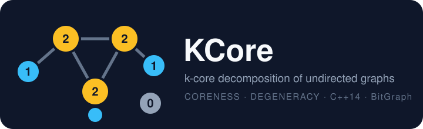

<p align="center">
  
</p>

<p align="center">
  
  
  
</p>

# k-core decomposition of undirected graphs

Header-only C++ class `KCore<GraphT>` that computes the **coreness** of every vertex of an undirected graph (or of the subgraph induced by a set of vertices) in O(|E|) time, using the bin-sort algorithm of Batagelj and Zaversnik. It is built on the bitset-based [BitGraph](https://github.com/psanse/BitGraph) library.

From the decomposition it also provides:

- the maximum core number (the *degeneracy* of the graph) and the sizes and vertex sets of the k-cores;
- a degeneracy ordering of the vertices (non-decreasing coreness);
- the width of a vertex ordering, and a quadratic-time reference implementation to cross-check the core number;
- a variant of the decomposition for a known upper bound on the core number (`find_kcore_UB`);
- greedy clique heuristics based on the degeneracy ordering.

> **Status:** work in progress. The enabled unit tests pass with BitGraph v2.0.0; see [Known issues](#known-issues).

## Usage

Include [`src/kcore.h`](src/kcore.h) and decompose a graph:

```cpp
#include "kcore.h"

bitgraph::ugraph ug{ 4 };            // star graph
ug.add_edge(0, 1);
ug.add_edge(0, 2);
ug.add_edge(0, 3);

bitgraph::KCore<bitgraph::ugraph> kc{ ug };
kc.find_kcore();                     // O(|E|)

int k  = kc.max_core_number();       // 1
int c  = kc.coreness(2);             // 1
auto s = kc.core_set(1);             // vertices in the 1-core
```

To decompose an induced subgraph, pass the vertex set to the constructor and call `find_kcore(true)`:

```cpp
std::vector<int> subgraph = { 0, 2, 3 };
bitgraph::KCore<bitgraph::ugraph> kc{ ug, subgraph };
kc.find_kcore(true);
```

See [`src/tests/test_kcore.cpp`](src/tests/test_kcore.cpp) for more examples.

## API

| Member | Description |
|---|---|
| `find_kcore(is_subg = false)` | Computes coreness and the degeneracy ordering, for the whole graph or the induced subgraph. |
| `find_kcore(g)` (static) | Maximum core number in O(\|V\|²), via the width of a minimum degenerate ordering. Reference implementation. |
| `find_kcore_UB(UB)` | Degeneracy ordering assuming `UB` is an upper bound of the core number. Only for the full graph. |
| `max_core_number()` | Maximum core number, or -1 if there is no decomposition. |
| `coreness(v)` / `coreness_numbers()` | Core number of a vertex / of all vertices. |
| `core_size(k)` / `core_set(k)` | Number of vertices with core number `k` / vertices with core number at least `k`. |
| `kcore_ordering()` | Vertices in non-decreasing coreness order. |
| `minimum_width(rev = false)` | Width of the graph for the stored ordering (heavy, meant for tests). |
| `find_heur_clique*()` | Greedy clique heuristics over the degeneracy ordering. |

## Build

BitGraph and GoogleTest are fetched automatically by CMake (`FetchContent`), so you only need a C++14 compiler and CMake 3.14 or later.

```bash
cmake -S . -B build
cmake --build build --config Release
ctest --test-dir build -C Release        # run the unit tests
```

## Known issues

- Some tests are disabled (`DISABLED_kcore_decomp_subgraph`, `DISABLED_kcore_example_I`, `DISABLED_random`).

## Project layout

```
src/kcore.h            KCore class (header-only)
src/tests/             GoogleTest unit tests
docs/logo.svg          project logo
CMakeLists.txt         fetches BitGraph and GoogleTest
```

## Author

[Pablo San Segundo](https://github.com/psanse)
